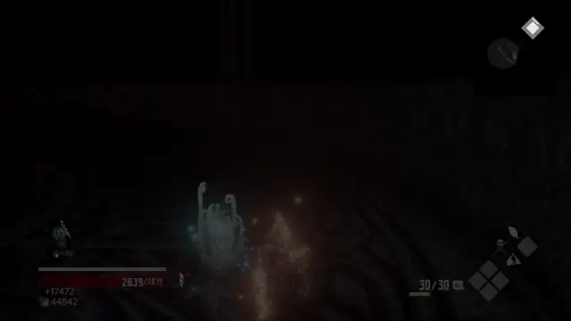
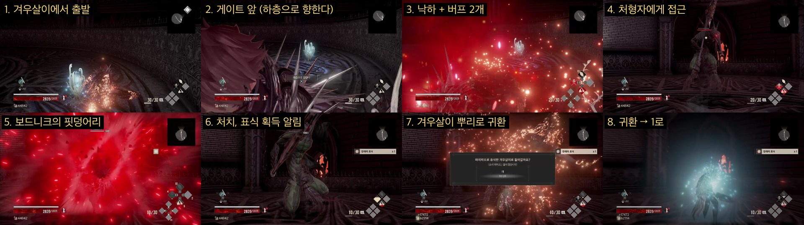
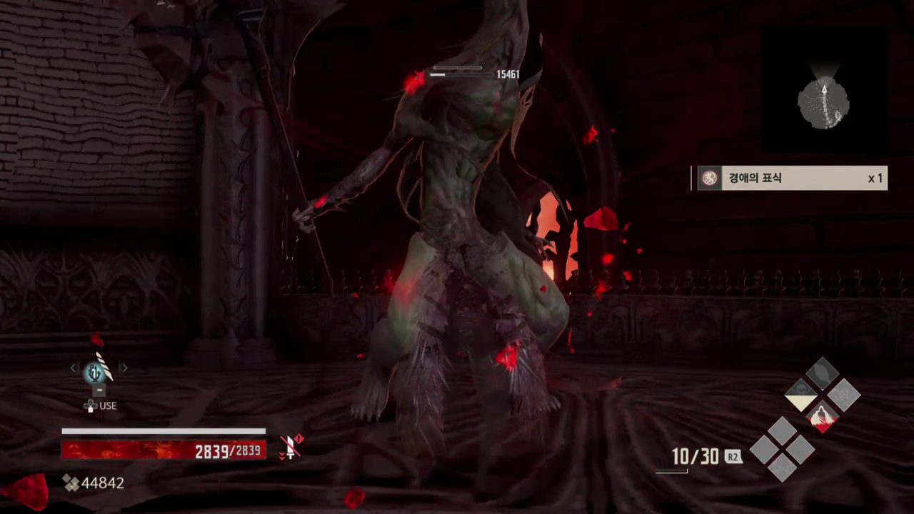
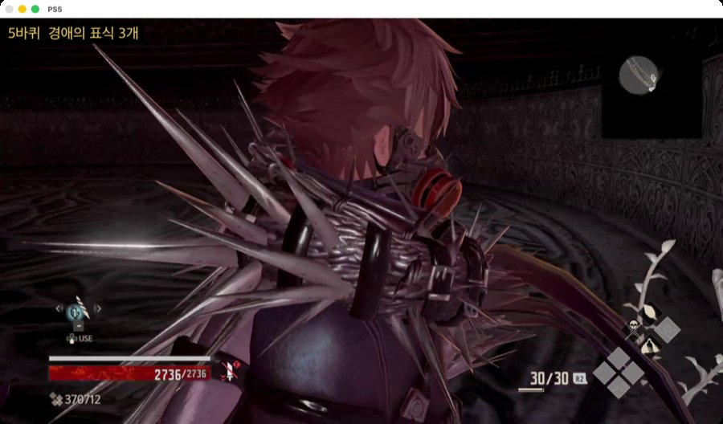

# Code Vein 경애의 표식 파밍 매크로 (PS5 Remote Play + Mac)

PS5에서 돌아가는 Code Vein을 Mac에서 Remote Play로 받아, **시련의 탑 II 1층 처형자**를 무한 반복으로 잡아 **경애의 표식** 400개를 모으는 매크로입니다.

- 녹화한 듀얼센스 입력(아날로그 그대로)을 재생하고, 매 단계는 **화면을 보고 확인**한 뒤에만 다음으로 넘어갑니다.
- 코드베인 게임 화면이 아니면 버튼을 누르지 않습니다.
- 오른쪽 아이템 알림을 글자로 읽어 표식 개수를 세고, 화면 왼쪽 위에 진행 상황을 띄웁니다.
- 400개가 모이면 스스로 멈추고 PS5를 휴식 모드로 보냅니다.





## 한 바퀴 흐름 (약 27초)

| 단계 | 하는 일 | 확인 방법 |
|---|---|---|
| 1. 겨우살이에서 출발 | 귀환 직후 "겨우살이에서 휴식한다" 문구가 뜰 때까지 기다림 | 문구 밝기 + 글자 인식 |
| 2. 게이트 앞까지 걷기 | 녹화 재생 (약 2.4초) | "하층으로 향한다" 문구 인식. 안 보이면 조금씩 뒤로 걸어 봄 |
| 3. 게이트 열기 | × | 문구가 사라졌는지 확인, 안 열리면 한 번 더 |
| 4. 낙하 중 버프 | R2+× 밤 안개의 옷, R2+□ 블랙 샤우트 | 오른쪽 아래 명혈(`NN/30`)이 6, 4씩 줄었는지 확인, 안 줄었으면 다시 |
| 5. 접근 + 막타 | 녹화 재생, R2+△ 보드니크의 핏덩어리 | 재생 중 게임 화면이 사라지면 중단 |
| 6. 표식 세기 | 오른쪽 위 획득 알림 읽기 | 글자 인식 (`경애의 표식 x1`) |
| 7. 귀환 | ↓ → 확인창 → ↑ × (겨우살이 뿌리) | 확인창 글자("돌아갈")를 본 뒤에만 누름 |



## 빌드 세팅

녹화가 이 세팅 기준이라 **버튼 위치와 장비 무게가 같아야** 재생이 맞습니다.

**블러드 코드**: 아르테미스 (의지 A라서 아래 연혈 계승 조건을 전부 충족)

**액티브 연혈 (R2 팔레트)**

| 버튼 | 연혈 | 원래 블러드 코드 | 명혈 |
|---|---|---|---|
| R2 + × | 밤 안개의 옷 (은신) | 헤임달 | 6 |
| R2 + □ | 블랙 샤우트 (다음 연혈 위력 증가) | 여왕의 후해 | 4 |
| R2 + △ | 보드니크의 핏덩어리 (막타) | 여왕의 늑해 | 10 |

**패시브 연혈**
- 아이템 입수율 상승 (헤르메스): 필수. 헤르메스 혈영 II 복원이 필요합니다.
- 연혈 발동 단축 (여왕의 조해 쪽)

**장비와 설정**
- 흡혈아장: 정신·의지 보정이 높은 경량형
- 무기: 가장 가벼운 것 (공격에는 쓰지 않고, 구르기 속도용)
- 아이템 단축칸: **겨우살이 뿌리 하나만**
- 동료: 없음
- 카메라: 반전 끔, 감도 50/50, 장애물 자동 회피 끔

## 실제 결과

| 항목 | 값 |
|---|---|
| 한 바퀴 | 약 27초 |
| 표식 드랍률 | 약 25% (아이템 입수율 상승 포함) |
| 시간당 | 약 32개 |
| 400개까지 | 실제 가동 약 12~13시간 |
| 실패율 | 게이트 못 닿음 약 2%, 귀환 실패 약 0.5% (둘 다 자동 복구) |

Remote Play로 보낸 버튼 입력이 가끔 빠지거나 엉뚱하게 눌립니다(원인 추정과 고칠 방법은 [ISSUES.md](ISSUES.md)). 그래서 탭할 때마다 떼기를 한 번 더 보내고, 매 동작을 화면으로 확인합니다. PC에서 직접 입력하는 매크로(시간당 약 40개)보다 느린 이유가 이 확인 대기와 귀환 로딩입니다.

## 준비물

- macOS (글자 인식에 macOS Vision 사용), Python 3.9
- PS5와 PSN 계정, PS5 원격 플레이 켜기 (설정 → 시스템 → 원격 플레이)
- 듀얼센스 (경로 녹화할 때만 Mac에 연결)
- 유선 LAN 권장

## 설치

[uv](https://docs.astral.sh/uv/)로 설치합니다. Python 3.9가 없으면 uv가 받아 옵니다.

```bash
uv sync
```

Apple Silicon Mac에서는 uv도 arm64 빌드여야 arm64 Python을 받습니다(`file $(which uv)`로 확인). Intel용 uv면 Rosetta용 Python이 깔립니다.

[ps5rmtctl](https://github.com/souriscloud/ps5rmtctl)(pyremoteplay 기반)로 PSN 로그인과 PS5 등록을 한 번 합니다. 로그인 정보는 `~/.pyremoteplay/`, `~/.ps5rmtctl/`에 저장되고 이 저장소에는 들어가지 않습니다.

```bash
uv run python -m ps5rmtctl discover
```

```bash
uv run python -m ps5rmtctl login
```

PS5의 설정 → 시스템 → 원격 플레이 → 기기 연결에서 PIN을 띄운 뒤:

```bash
uv run python -m ps5rmtctl register --host <PS5 IP> --pin <8자리 PIN>
```

```bash
uv run python -m ps5rmtctl setup
```

## 사용 절차

### 1. 경로 녹화 (처음 한 번)

캐릭터를 시련의 탑 II 1층 겨우살이 앞에 세우고, 위 빌드 세팅을 맞춥니다.

```bash
uv run python -u ps5view.py
```

다른 터미널에서 듀얼센스를 Mac에 연결하고:

```bash
uv run python -u padlink.py routes/analog_last.json
```

1. 듀얼센스로 PS5를 조작할 수 있습니다. **터치패드 클릭**으로 녹화를 시작합니다.
2. 겨우살이에서 게이트까지 걸어가 ×로 열고, 낙하 중 버프 2개 → 처형자에게 접근 → R2+△로 처치까지 한 번 합니다.
3. **터치패드 클릭**으로 녹화를 끝냅니다. 매크로는 녹화를 첫 ×(게이트) 앞뒤로 나눠서, 게이트와 버프는 화면을 보며 직접 처리하고 나머지만 재생합니다.

녹화가 끝나면 듀얼센스를 Mac에서 끊어 둡니다. **PS5에 직접 연결하거나 PS 버튼을 누르면** Remote Play 세션이 끊기거나 PS5 홈 화면으로 빠집니다.

### 2. 파밍 실행

캐릭터를 겨우살이 앞에 둔 상태에서:

```bash
uv run python -u run.py
```

- PS5 화면 창이 뜨고, 왼쪽 위에 `N바퀴 경애의 표식 약 N개 (남은 N개)`가 표시됩니다.

  

- 기록은 `routes/farm_log.txt`에 남고, 다시 켜면 바퀴 수와 누적 개수를 이어서 셉니다.
- 게임 안 실제 개수와 다르면 `farm.py`의 `MARK_OFFSET`을 맞춰 주세요. 처음 시작할 때 이미 모은 개수도 여기에 넣습니다.
- 끄려면 터미널에서 Ctrl+C. **바퀴 기록이 찍힌 직후**에 끄면 다음에 손해 없이 이어집니다.

### 3. 자동 복구와 멈춤

| 상황 | 동작 |
|---|---|
| 게이트에 못 닿음 | 그 바퀴만 건너뛰고 귀환 후 다시 |
| 3번 연속 실패 | 화면이 멈춘 것으로 보고 Remote Play를 다시 연결 |
| 처형자가 살아남아 귀환 실패 | 겨우살이로 돌아올 때까지 기다림 (죽으면 겨우살이에서 부활) |
| PS5 홈 화면으로 빠짐 | ○ → × 로 코드베인으로 복귀 |
| 아이템 팔레트 편집 창이 열림 | ○로 닫음 (↓ 떼기 신호가 빠졌을 때 생김) |
| 90초 안에 겨우살이로 못 돌아옴 | 멈춤. 캐릭터를 겨우살이 앞에 두고 다시 실행 |
| 400개 달성 | 귀환 후 PS5를 휴식 모드로 보내고 종료 |

### 주의

- 실행 중에는 **모니터·TV를 끄지 마세요.** PS5의 HDMI 기기 연동 "전원 끄기 연동"이 켜져 있으면 PS5도 같이 꺼집니다.
- Remote Play 세션은 PS5당 하나라, 매크로가 도는 동안 PS 앱이나 chiaki로 붙을 수 없습니다.
- 확인용 캡처는 `routes/debug/`에 최근 200장만 640px JPEG로 남습니다.

## 파일

| 파일 | 역할 |
|---|---|
| `run.py` | 실행기. 뷰어와 파밍을 켜고, 끊기면 다시 연결 |
| `ps5view.py` | Remote Play 화면 창 + 조작 명령 포트(127.0.0.1:8650) |
| `farm.py` | 파밍 반복, 화면 판정, 표식 세기 |
| `pscmd.py` | 명령 포트 클라이언트 (`uv run python pscmd.py snap out.png` 등) |
| `padlink.py` | 듀얼센스 → PS5 전달 + 아날로그 녹화 |
| `ocr.py` | macOS Vision 한국어 글자 인식 |
| `routes/analog_last.json` | 녹화한 한 바퀴 (작성자 빌드 기준) |

## 참고

- [souriscloud/ps5rmtctl](https://github.com/souriscloud/ps5rmtctl), [pyremoteplay](https://github.com/ktnrg45/pyremoteplay)
- 파밍 방법: [Steam 토론](https://steamcommunity.com/app/678960/discussions/0/3195866053907624087), [Fextralife Vodnik Mass](https://codevein.wiki.fextralife.com/Vodnik+Mass)
